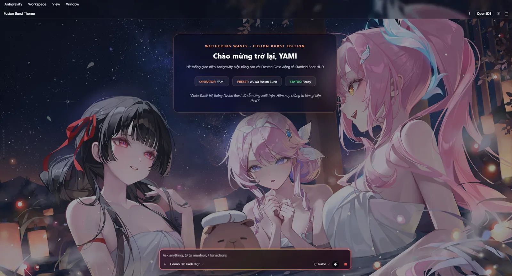

# Antigravity Custom Theme & Boot Studio

Bộ công cụ tùy biến giao diện cao cấp cho **Google Antigravity**, hỗ trợ hình nền động (Live Video Wallpaper), hiệu ứng kính mờ (Frosted Glass), âm thanh chào mừng cùng màn hình khởi động phong cách khoa học viễn tưởng (Sci-Fi Boot HUD) — hoàn toàn không can thiệp hay sửa đổi tệp cài đặt gốc (`app.asar`) của ứng dụng.



---

## Điểm nổi bật & Tính năng mới

- 🚀 **Khởi động tức thì (Zero-Flash Dark Boot):** Triệt tiêu hoàn toàn hiện tượng chớp trắng (white flash) khi mở ứng dụng nhờ đồng bộ màu canvas CDP và kỹ thuật chèn màn che tối ngay tại `document_start`.
- 👤 **Tùy biến tên định danh (Custom Operator Name):** Dễ dàng thay đổi tên hiển thị trên màn hình khởi động (Boot HUD) và thẻ định danh hệ thống trực tiếp trong bảng cài đặt.
- 🎨 **Bộ sưu tập Preset độc đáo:**
  - **WuWa Fusion Burst**: Tông màu hoa anh đào rực rỡ và ánh lửa hổ phách (Changli, Encore & Danjin).
  - **Gemini-chan Live**: Không gian tuyết tím kỳ ảo kèm video nền động mượt mà.
  - **Furina Live**: Nhịp điệu Thủy Quốc trang nhã, lung linh.
  - **WLOP Cosmic**: Bầu trời sao kỳ vĩ, huyền bí.
  - **Midnight Obsidian**: Giao diện tối giản, sang trọng cho môi trường làm việc tập trung.
- ✨ **Hiệu ứng vẽ nét & Loang màu (Sketch Reveal):** Tự động trích xuất các đường nét nghệ thuật từ ảnh/video nền trước khi phủ màu, mang lại cảm giác mở màn ấn tượng.
- 🌌 **Màn hình khởi động Starfield Boot HUD:** Tái hiện trình tự xác thực không gian vũ trụ với âm thanh chào mừng (Tawa Voice) và hiệu ứng chuyển cảnh đa tầng.
- 💬 **Lời chào tùy chỉnh & Voice hoàn thành tác vụ:** Tự soạn câu chào hiển thị trên khung chat trống và phát âm thanh thông báo mỗi khi hoàn tất tác vụ.
- 🛡️ **An toàn & Ổn định (Non-invasive):** Hoạt động độc lập qua giao thức Chrome DevTools Protocol (CDP), giữ nguyên tính toàn vẹn của ứng dụng và không bị mất cài đặt khi Antigravity tự động cập nhật.
- ⚡ **Build nhẹ nhàng với Node.js:** Hỗ trợ biên dịch payload trực tiếp bằng `Node.js` tích hợp sẵn, không bắt buộc cài thêm Python.

---

## Kiến trúc hệ thống

Dự án hoạt động theo mô hình 2 tầng tách biệt:

1. **Daemon nền & Local Media Server (`daemon/theme_daemon.js`):**
   - Tự động nhận diện cổng gỡ lỗi (`DevToolsActivePort`) của Antigravity và kết nối qua CDP.
   - Vận hành máy chủ media nội bộ trên `127.0.0.1` phục vụ phát video phân đoạn (`Range 206`), tải lên và quản lý thư viện tệp nền.
   - Giám sát cập nhật từ `dist/theme_payload.js` để tự động tải lại giao diện tức thì (hot-reload).

2. **Runtime Theme Engine (`engine/core.js`):**
   - Đóng gói toàn bộ preset, asset âm thanh, phông chữ viết tay thành `dist/theme_payload.js` tự chứa (self-contained).
   - Dựng bảng điều khiển **Custom Theme Studio**, điều khiển lớp kính mờ GPU và quản lý trạng thái cá nhân hóa trong `theme_config.json`.

---

## Yêu cầu môi trường

- **Google Antigravity**
- **Node.js >= 22** (sử dụng WebSocket gốc, không cần cài đặt gói ngoài qua `npm`)
- *(Tùy chọn)* **Python >= 3.9** nếu bạn muốn sử dụng bộ build python thay thế

---

## Hướng dẫn cài đặt & Sử dụng

### 1. Tải mã nguồn

```bash
git clone https://github.com/HuyTuyen00/antigravity-custom-theme-mod.git
cd antigravity-custom-theme-mod
```

### 2. Đóng gói giao diện (`dist/theme_payload.js`)

Chạy lệnh đóng gói bằng Node.js:

```bash
node scripts/build_payload.js
```

*(hoặc dùng lệnh Python nếu máy có sẵn Python: `python scripts/build_payload.py`)*

### 3. Cài đặt và khởi chạy dịch vụ ngầm

**Trên hệ điều hành Windows (PowerShell):**

```powershell
powershell -ExecutionPolicy Bypass -File ".\scripts\install-win.ps1"
```

> **Ghi chú:** Script sẽ tạo phím tắt tự khởi động ngầm cùng Windows (`Startup`), tự động kết nối và áp dụng theme mỗi khi bạn mở Antigravity.

**Trên macOS / Linux:**

```bash
bash scripts/install-unix.sh
```

### 4. Mở bảng điều khiển giao diện (Custom Theme Studio)

Khi Antigravity đang chạy:
- Bấm vào mục **Custom theme** ở thanh menu bên trái.
- Hoặc vào **Settings** > **Appearance** > bấm **Open Custom Theme Studio**.

Tại đây bạn có thể:
- Chọn preset yêu thích hoặc tải lên hình nền / video riêng.
- Nhập **Tên người dùng** (Operator Name) để cá nhân hóa màn hình khởi động.
- Tùy chỉnh độ mờ kính, độ tối nền (Dimming) và câu chào cá nhân.

---

## Gỡ cài đặt

Để dừng dịch vụ và đưa Antigravity về giao diện ban đầu:

```bash
node scripts/uninstall.js
```

---

## Cấu trúc thư mục

```text
.
├── daemon/
│   └── theme_daemon.js        # Dịch vụ nền kết nối CDP, HTTP server nội bộ và đồng bộ cấu hình
├── engine/
│   └── core.js                # Bộ máy render runtime: Boot HUD, Theme Studio, Sketch Reveal
├── scripts/
│   ├── build_payload.js       # Trình đóng gói payload giao diện bằng Node.js
│   ├── build_payload.py       # Trình đóng gói payload giao diện bằng Python
│   ├── install-win.ps1        # Script cài đặt tự động cho Windows
│   ├── install-unix.sh        # Script cài đặt cho macOS / Linux
│   ├── uninstall.js           # Gỡ bỏ dịch vụ và khôi phục giao diện gốc
│   └── verify_cdp.js          # Kiểm tra kết nối CDP tới Antigravity
├── themes/
│   ├── themes.json            # Danh mục các chủ đề giao diện mặc định
│   ├── assets/                # Kho hình ảnh, video, âm thanh và font chữ
│   └── user_media/            # Thư mục chứa tệp cá nhân hóa của người dùng
├── docs/                      # Tài liệu và hình ảnh minh họa
└── LICENSE                    # Giấy phép nguồn mở MIT
```

---

## Giấy phép

Dự án được phát hành theo giấy phép tự do nguồn mở **MIT License** — xem chi tiết tại tệp [LICENSE](LICENSE).
